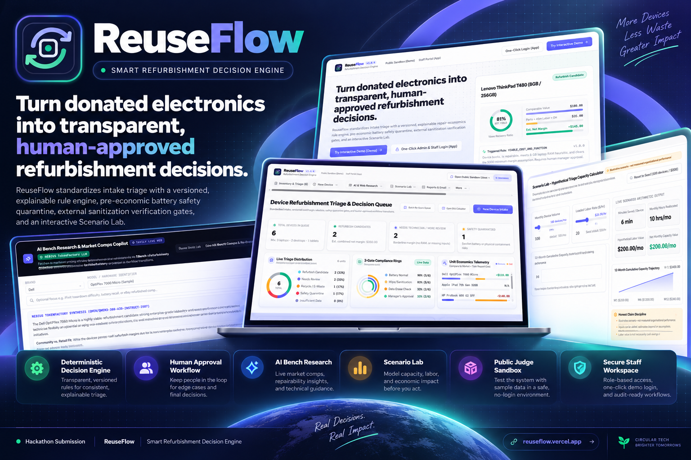
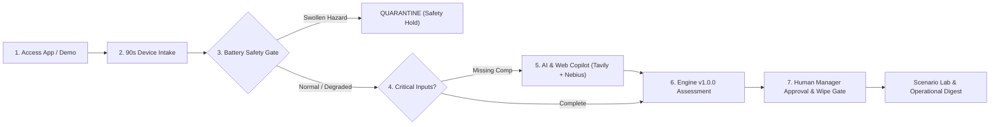
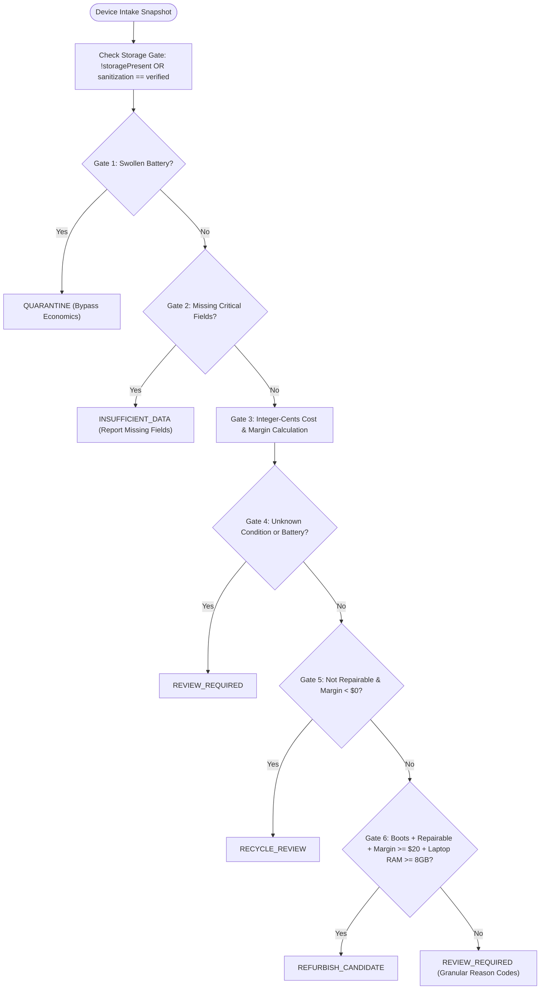
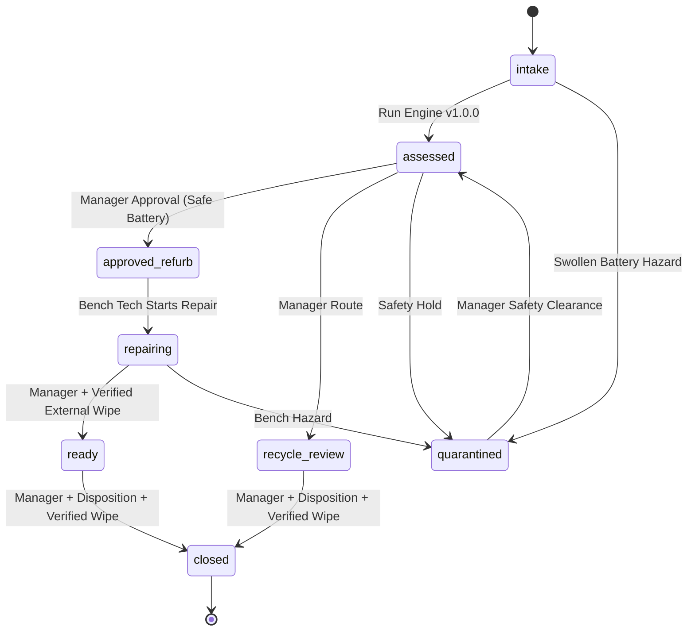
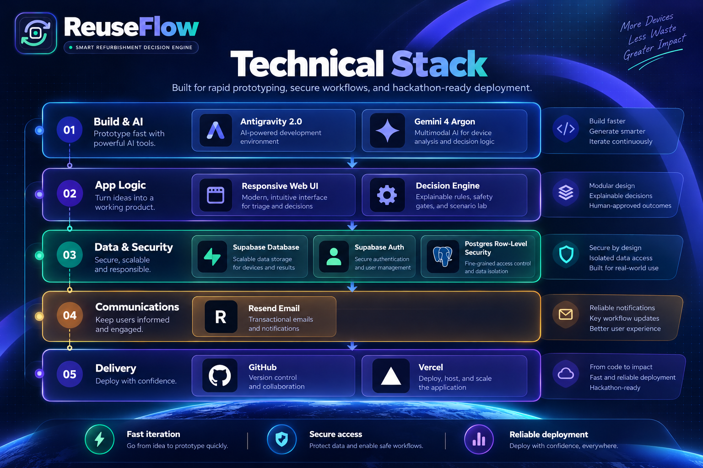
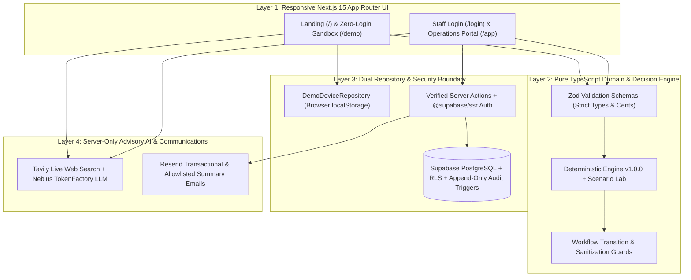

<div align="center">



<br />

# ReuseFlow — Smart Refurbishment Decision Engine

**Turn donated electronics into transparent, human-approved refurbishment decisions and measurable operational outcomes.**  
*Built for the **FUSE Society Blueprint 2026** Case & Hackathon Competition*

<p align="center">
  <a href="https://reuseflow.vercel.app"></a>
  <a href="https://reuseflow.vercel.app/demo"></a>
  <a href="https://reuseflow.vercel.app/login"></a>
</p>

<p align="center">
  <a href="LICENSE"></a>
  
  
  
  
  
</p>

<p align="center">
  <a href="#1-how-reuseflow-works">Workflow</a> ·
  <a href="#2-public-judge-sandbox-demo">Judge Sandbox</a> ·
  <a href="#3-inventory--explainable-triage-engine-v100">Triage Engine</a> ·
  <a href="#4-ai--live-web-bench-research-copilot">AI Copilot</a> ·
  <a href="#5-scenario-lab--capacity-calculator">Scenario Lab</a> ·
  <a href="#6-secure-staff-workspace--governance-app">Staff Security</a> ·
  <a href="#7-technical-architecture--flow-diagrams">Architecture</a> ·
  <a href="docs/TECHNICAL_DOCUMENTATION.md">Full Technical Docs</a>
</p>

</div>

---

> [!IMPORTANT]
> **Scope, Safety & Honesty Disclosure:** ReuseFlow is an open-source (`GPL-3.0`) hackathon prototype for a *proposed* internal electronics refurbishment triage and decision-support workflow. It is **not** an official or endorsed operational system of Free Geek, **never** performs certified device data wiping or automated e-waste disposal, and all sample devices in `/demo` use 100% synthetic data with zero personal donor/recipient information or real serial numbers. Case-specific alignment in [`docs/CASE_ALIGNMENT.md`](docs/CASE_ALIGNMENT.md) uses permitted participant framing without redistributing any restricted competition packet.

---

## Executive Problem & Proposed Solution

Nonprofit hardware reuse and digital inclusion organizations process mixed pallets of donated laptops, desktops, and tablets under tight bench-labor budgets. Without a standardized intake and unit-economics triage gate:
- Technicians spend precious bench minutes diagnosing low-margin or non-repairable units before checking economic viability.
- Physical lithium-ion hazards (**swollen batteries**) and **storage data-sanitization holds** risk being tracked informally across spreadsheets or paper tags.
- Edge cases (such as missing secondary-market comparable prices) stall intake queues without a consistent escalation path.

**ReuseFlow** solves this operational bottleneck through a **human-in-the-loop refurbishment decision engine**:
- **90-Second Standardized Intake:** Structured capture of hardware specs, boot health, cosmetic grade, battery safety, storage media presence, parts/labor estimates, and manual comparable value.
- **Deterministic Integer-Cents Rule Engine (`v1.0.0`):** Pure, versioned scoring returning transparent reason codes (`VIABLE_COST_AND_FUNCTION`, `SAFETY_BATTERY_SWOLLEN`, `LOW_RAM`, `BELOW_MARGIN_THRESHOLD`, `SANITIZATION_GATE_PENDING`) and a non-destructive **"What-If?"** parts cost simulator.
- **Hard Safety & Sanitization Gates:** Swollen batteries trigger immediate `QUARANTINE` *before* any economic calculation. Storage-bearing devices are locked from reaching `ready` or `closed` until a manager records human verification of an external sanitization procedure.
- **Advisory AI & Live Web Research Copilot:** Integrates **Tavily Search API** + **Nebius TokenFactory LLM** to surface cited secondary-market comparable prices and teardown notes while preserving strict human confirmation before updating `v1.0.0` inputs.

---

## 1. How ReuseFlow Works

<p align="center">
  
</p>

Every donated device progresses through a transparent, auditable 7-stage lifecycle where physical safety and external data sanitization take precedence over economic scoring, and **every final routing decision requires human supervisor approval**:



| Outcome | Engine Code | Operational Meaning |
| :--- | :--- | :--- |
| **Refurbish Candidate** | `REFURBISH_CANDIDATE` | Boots cleanly, repairable, meets RAM floor (`>= 8 GB` laptop), and clears minimum positive net margin (`>= $20.00`). |
| **Needs Human Review** | `REVIEW_REQUIRED` | Borderline net margin, `< 8 GB` or unknown laptop RAM, boot failure, degraded battery, or unverified physical condition. |
| **Recycle / E-Waste Review** | `RECYCLE_REVIEW` | Non-repairable **and** negative net margin (`repairCost > comparableValue`); routed for human-approved responsible recycling. |
| **Safety Quarantine** | `QUARANTINE` | Swollen battery detected (`SAFETY_BATTERY_SWOLLEN`); overrides all economics and locks refurbishment approval. |
| **Insufficient Data** | `INSUFFICIENT_DATA` | Missing critical inputs (e.g., `comparableValueCents`); lists exact missing fields rather than guessing zero. |

---

## 2. Public Judge Sandbox (`/demo`)

<p align="center">
  
</p>

Judges and reviewers can evaluate every feature immediately at **[reuseflow.vercel.app/demo](https://reuseflow.vercel.app/demo)** with **zero login or setup**:
- **100% Isolated Browser-Local State:** Powered by `DemoDeviceRepository` (`localStorage`), ensuring sandbox edits never touch production Supabase tables or trigger live Resend emails.
- **Preloaded Worked Edge Cases (`Case A`–`Case F`):** Demonstrates viable refurbishment, borderline low-RAM laptops, swollen battery quarantine, negative-margin recycle review, missing comparable value lookup, and pending storage sanitization locks.
- **Live Role Simulator & Instant Reset:** Toggle seamlessly between `Manager (Can Approve & Verify)`, `Technician (Intake & Assess)`, and `Viewer (Read-Only)` permissions, or restore canonical seed fixtures in one click.

---

## 3. Inventory & Explainable Triage Engine (`v1.0.0`)

<p align="center">
  
</p>

The **Refurbishment Operations Command Center** standardizes bench intake and surfaces real-time queue telemetry:
- **Live Triage Distribution & 3-Gate Compliance Rings:** Instant SVG visualizations tracking candidate breakdown, physical battery clearance, external data-wipe verification, and manager sign-off ratios.
- **Unit Economics Telemetry & Integer-Cents Math:** Computes `totalRepairCostCents = partsCostCents + round(estimatedLaborMinutes * hourlyRateCents / 60) + overheadCents` and `marginCents = comparableValueCents - totalRepairCostCents` with zero floating-point rounding errors.
- **Non-Destructive "What-If?" Parts Simulator & Shop-Floor Bench Traveler:** Technicians can test alternative part costs without mutating stored records and print non-PII physical bench travelers for shop-floor tracking.

### Decision Engine `v1.0.0` Evaluation Priority Tree



---

## 4. AI & Live Web Bench Research Copilot

<p align="center">
  
</p>

When donated hardware arrives without a known market comparable value (such as **Case E · `FG-DEMO-105`**), technicians can launch the **AI Bench Research & Market Comps Copilot** (`/api/research/device-intel`):
- **Live Cited Web Comps (`Tavily Search API`):** Queries current secondary-market refurbished listings and repairability references with clickable source links.
- **Structured Technician Brief (`Nebius TokenFactory LLM`):** Synthesizes conservative low, suggested midpoint, and retail high comparable estimates alongside model-specific parts budgets and common failure checkpoints using `Qwen/Qwen3-30B-A3B-Instruct-2507` (with deterministic spec-tier fallback if external APIs are offline).
- **Strict Human-in-the-Loop Governance:** AI outputs are **100% advisory**. Staff must review the cited sources and explicitly click **Apply Comp & Re-Evaluate** before the deterministic `v1.0.0` engine updates unit economics.

---

## 5. Scenario Lab — Capacity Calculator

<p align="center">
  
</p>

Built for nonprofit operations leads and competition judges, **Scenario Lab** (`src/lib/decision/scenario.ts`) models how faster, standardized intake affects monthly bench capacity before implementation:
- **Interactive Sensitivity Controls:** Adjust monthly donated device volume (`devices/mo`), loaded technician labor rate (`$/hr`), manual baseline minutes vs. ReuseFlow target minutes, one-time pilot setup cost, and monthly hosting cost.
- **12-Month Cumulative Capacity Trajectory:** Visualizes monthly hours reallocated to hands-on refurbishment and simple payback periods.
- **Honest Claim Discipline:** Explicitly distinguishes hypothetical bench-capacity reallocation from guaranteed cash savings or verified partner financial performance.

---

## 6. Secure Staff Workspace & Governance (`/app`)

<p align="center">
  
</p>

At **[reuseflow.vercel.app/login](https://reuseflow.vercel.app/login)**, ReuseFlow provides production-grade authentication, role governance, and multi-tenant account isolation:
- **One-Click Hackathon Demo Logins:** Instant pre-seeded access as **Admin / Manager**, **Staff / Technician**, or **Read-Only Auditor** against the live Supabase PostgreSQL database.
- **Full Self-Service Account Lifecycle:** New staff registration (with automatic isolated workspace provisioning & Resend welcome email), password recovery via email, profile editing, and password updates.
- **Per-User Isolated Postgres Workspaces (`created_by = auth.uid()`):** Each registered user operates inside an isolated RLS-enforced workspace with dedicated `user_settings`, devices, assessments, and audit events.
- **Append-Only Audit Trail & State Preconditions:** PostgreSQL triggers block `UPDATE` and `DELETE` on `assessments` and `workflow_events`, preserving a complete chain of custody.

### Human-Approved Workflow State Machine



---

## 7. Technical Architecture & Flow Diagrams

<p align="center">
  
</p>

> **Deep-Dive Engineering Reference:** For complete ER diagrams, sequence flows, SQL `CHECK` constraints, RLS policies, Server Action contracts, and Scenario Lab equations, read **[`docs/TECHNICAL_DOCUMENTATION.md`](docs/TECHNICAL_DOCUMENTATION.md)**.

### Layered System Architecture



### Technology Stack Summary

| Layer | Technologies | Key Files |
| :--- | :--- | :--- |
| **Frontend & UX** | Next.js 15 (App Router), React 19, TypeScript (`strict: true`), Tailwind CSS v4, Lucide Icons, Custom SVG Telemetry | `src/app/`, `src/components/` |
| **Domain & Rules Engine** | Pure deterministic TypeScript, integer-cents math, Zod validation | `src/types/domain.ts`, `src/lib/decision/engine.ts`, `src/lib/decision/scenario.ts` |
| **AI & Web Research** | Tavily Search API + Nebius TokenFactory (`Qwen/Qwen3-30B-A3B-Instruct-2507`) + offline fallback | `src/lib/research/device-research-service.ts`, `src/app/api/research/device-intel/route.ts` |
| **Database, Auth & RLS** | Supabase PostgreSQL, `@supabase/ssr`, Row-Level Security, append-only triggers, `SECURITY DEFINER` seeding RPC | `supabase/migrations/`, `src/lib/repositories/supabase-repository.ts` |
| **Transactional Email** | Resend SDK (server-only, recipient allowlist, idempotency keys, rate limiting) | `src/lib/email/resend-service.ts`, `src/lib/email/auth-email-service.ts` |
| **Quality Assurance** | Vitest (unit & security integration suites), Playwright (desktop & 375px mobile E2E) | `tests/unit/`, `tests/integration/`, `tests/e2e/` |
| **Deployment & Prototyping** | GitHub (`GPL-3.0`), Vercel CI/CD, Google Antigravity 2.0 + Gemini 4 Argon | `docs/AI_DISCLOSURE.md` |

---

## 8. Worked PRD Fixtures Included in `/demo`

| Case | Asset Tag | Hardware & Scenario | Engine `v1.0.0` Output |
| :--- | :--- | :--- | :--- |
| **Case A** | `FG-DEMO-101` | Viable 8 GB Lenovo ThinkPad T480; boots; repairable; `$20` parts + `45m` labor (`$15`) vs `$180` comp | `REFURBISH_CANDIDATE` (`$35` cost, `+$145.00` net margin) |
| **Case B** | `FG-DEMO-102` | Borderline 4 GB Dell Latitude E5450; `$40` parts + `90m` labor (`$30`) vs `$70` comp | `REVIEW_REQUIRED` (`LOW_RAM`, `BELOW_MARGIN_THRESHOLD`) |
| **Case C** | `FG-DEMO-103` | High-spec 16 GB HP EliteBook 840 G5 with **swollen battery** | `QUARANTINE` (`SAFETY_BATTERY_SWOLLEN` overrides economics) |
| **Case D** | `FG-DEMO-104` | HP ProDesk 600 G2 SFF; no boot; not repairable; `$200` parts + `60m` labor (`$20`) vs `$80` comp | `RECYCLE_REVIEW` (`-$140.00` net margin; requires human review) |
| **Case E** | `FG-DEMO-105` | Apple iPad 7th Gen 32GB missing manual comparable value estimate | `INSUFFICIENT_DATA` (lists `comparableValueCents` for AI Copilot) |
| **Case F** | `FG-DEMO-106` | Viable Dell OptiPlex 7060 (`+$115.00` margin) with `storagePresent=true` and unverified wipe | `REFURBISH_CANDIDATE`, with `sanitizationGateOpen = false` locking `ready`/`closed` |

---

## 9. Local Setup, Environment & Verification

### Quickstart
```bash
git clone https://github.com/malinikochar/reuseflow.git
cd reuseflow
npm install
cp .env.example .env.local
npm run dev
```
- **Landing Page:** `http://localhost:3000`
- **Zero-Credential Public Judge Sandbox:** `http://localhost:3000/demo`
- **Staff Operations Portal:** `http://localhost:3000/login`

### Environment Variables (`.env.local` / Vercel)
```dotenv
# Public Supabase Configuration (Required only for /login and /app; /demo works offline)
NEXT_PUBLIC_SUPABASE_URL=https://your-project.supabase.co
NEXT_PUBLIC_SUPABASE_PUBLISHABLE_KEY=your-publishable-or-anon-key
NEXT_PUBLIC_SITE_URL=http://localhost:3000
NEXT_PUBLIC_DEMO_ENABLED=true

# Optional Server-Only Resend Email Configuration (Never prefix with NEXT_PUBLIC_)
RESEND_API_KEY=re_your_server_key
RESEND_FROM_EMAIL="ReuseFlow <updates@your-verified-domain.org>"
REPORT_RECIPIENT_ALLOWLIST="manager@your-verified-domain.org"

# Optional Server-Only AI & Web Bench Research Copilot (Never prefix with NEXT_PUBLIC_)
TAVILY_API_KEY=tvly_your_server_key
NEBIUS_API_KEY=your_nebius_tokenfactory_key
NEBIUS_BASE_URL=https://api.tokenfactory.nebius.com/v1
NEBIUS_MODEL=Qwen/Qwen3-30B-A3B-Instruct-2507
```

### Automated Quality Gate Suite
```bash
npm run typecheck   # Strict TypeScript compiler check (tsc --noEmit)
npm run lint        # ESLint Next.js & TypeScript static analysis
npm run test        # Vitest unit & security integration test suites
npm run build       # Production Next.js App Router build verification
npm run test:e2e    # Playwright desktop & mobile browser smoke suite
```

---

## 10. Project Documentation Index

| Document | Purpose |
| :--- | :--- |
| **[`docs/TECHNICAL_DOCUMENTATION.md`](docs/TECHNICAL_DOCUMENTATION.md)** | Complete architecture diagrams, decision engine flowcharts, state machine, Postgres ERD, RLS controls, and API reference. |
| **[`docs/CASE_ALIGNMENT.md`](docs/CASE_ALIGNMENT.md)** | FUSE Society Blueprint 2026 case alignment, problem framing, and strict non-claim boundaries. |
| **[`docs/DEMO_SCRIPT.md`](docs/DEMO_SCRIPT.md)** | Structured presentation and live demo walkthrough script. |
| **[`docs/TEST_REPORT.md`](docs/TEST_REPORT.md)** | Reproducible unit, integration, SQL RLS, and Playwright E2E verification report. |
| **[`docs/AI_DISCLOSURE.md`](docs/AI_DISCLOSURE.md)** | Transparent AI tooling & human verification disclosure for competition submission. |
| **[`ReuseFlow_PRD.md`](ReuseFlow_PRD.md)** | Full product requirements specification and acceptance criteria. |

---

## 11. Author & Open Source License

- **Author:** Malini Kochar (`malinikochar@gmail.com`) — [github.com/malinikochar/reuseflow](https://github.com/malinikochar/reuseflow)
- **License:** Distributed under the **GNU General Public License v3.0 (`GPL-3.0`)** in full compliance with FUSE Society Blueprint open-source hackathon rules. See [`LICENSE`](LICENSE) for complete terms.
