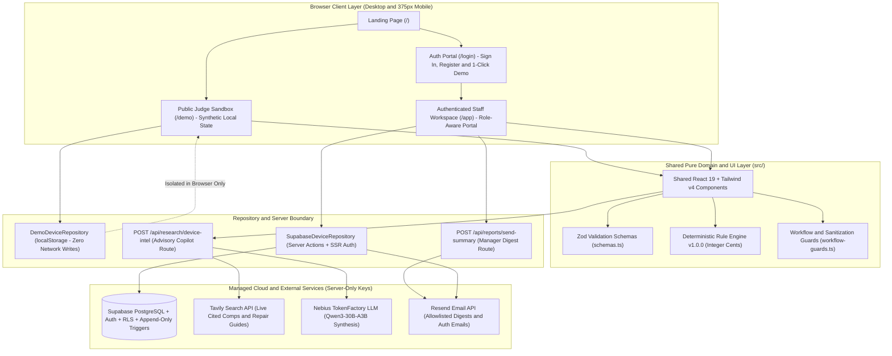
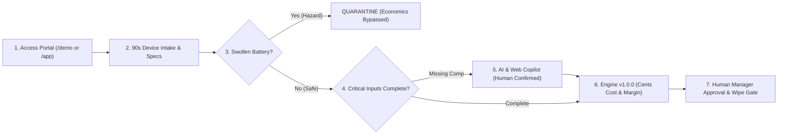
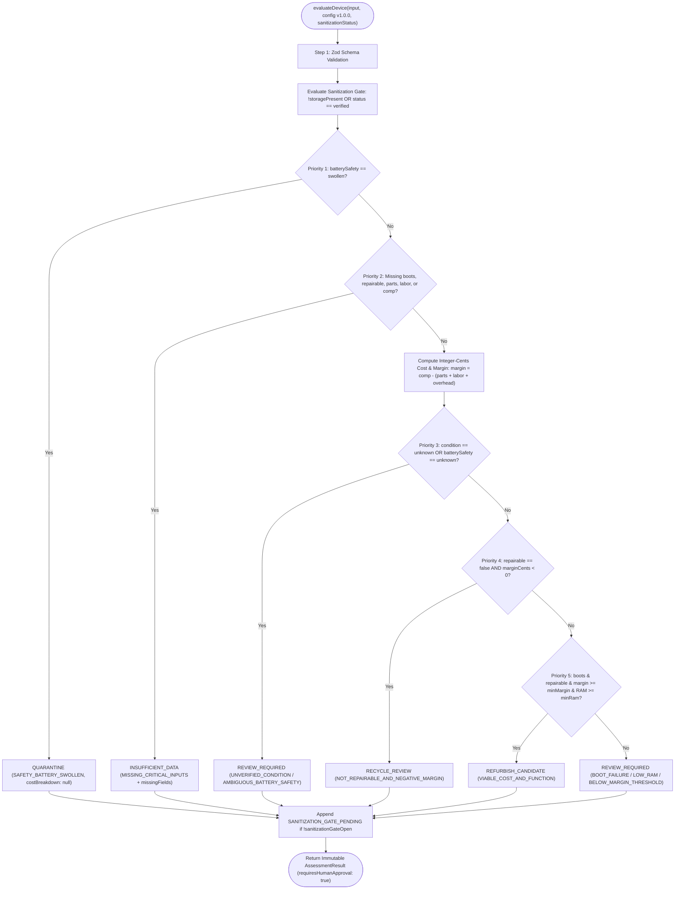
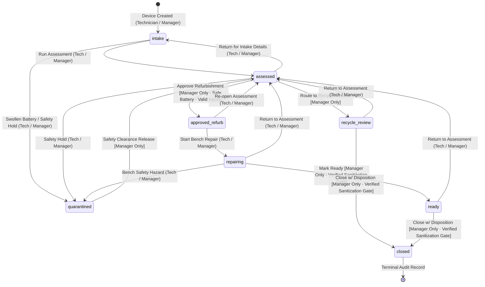
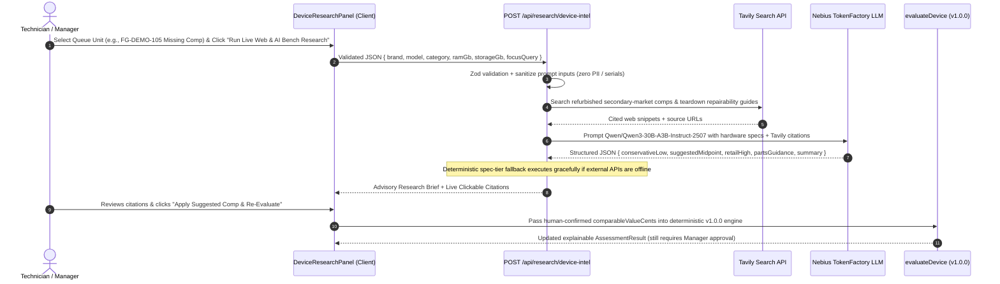
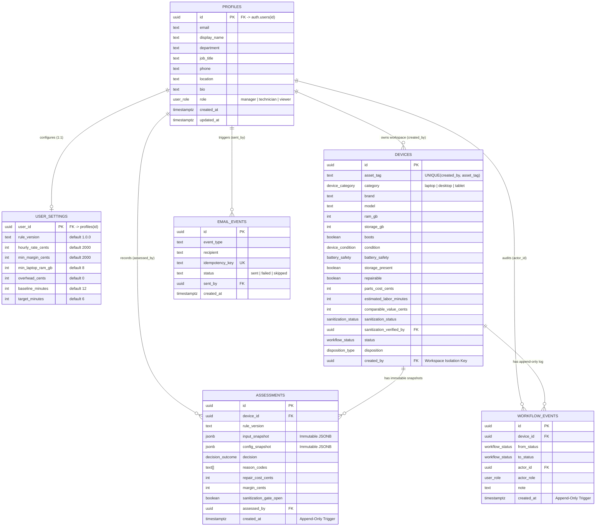

# ReuseFlow — Comprehensive Technical Architecture & Engineering Documentation

<p align="center">
  
</p>

<p align="center">
  <a href="https://reuseflow.vercel.app"><strong>Live Production App</strong></a> ·
  <a href="https://reuseflow.vercel.app/demo"><strong>Zero-Login Judge Sandbox (/demo)</strong></a> ·
  <a href="https://youtu.be/TsD79yBawuQ"><strong>Watch 2-Min Demo Video (YouTube)</strong></a>
</p>

> [!IMPORTANT]
> **Scope, Safety & Claim Discipline:** ReuseFlow is an open-source (`GPL-3.0`) hackathon MVP proposing a standardized refurbishment triage and decision-support workflow. It is **not** an official operational system of Free Geek, **never** performs certified device data wiping or automated hardware disposal, and requires **human supervisor approval** for all disposition and sanitization gates. Financial thresholds in Engine `v1.0.0` and Scenario Lab are transparent, editable hypotheses rather than industry standards.

---

## Table of Contents

1. [System Context & Architectural Principles](#1-system-context--architectural-principles)
2. [High-Level System Architecture Diagram](#2-high-level-system-architecture-diagram)
3. [End-to-End Operational Triage Flow](#3-end-to-end-operational-triage-flow)
4. [Deterministic Decision Engine (`v1.0.0`) Specification](#4-deterministic-decision-engine-v100-specification)
5. [Human-Approved Workflow State Machine & Safety Gates](#5-human-approved-workflow-state-machine--safety-gates)
6. [Advisory AI & Live Web Research Copilot Sequence](#6-advisory-ai--live-web-research-copilot-sequence)
7. [Database Schema, Constraints & Row-Level Security (ERD)](#7-database-schema-constraints--row-level-security-erd)
8. [Dual-Mode Repository Isolation (`/demo` vs `/app`)](#8-dual-mode-repository-isolation-demo-vs-app)
9. [Codebase Directory Structure & Module Responsibilities](#9-codebase-directory-structure--module-responsibilities)
10. [Server Actions, HTTP API Endpoints & Error Taxonomy](#10-server-actions-http-api-endpoints--error-taxonomy)
11. [Scenario Lab Mathematical Model](#11-scenario-lab-mathematical-model)
12. [Security, Safety & Verification Matrix](#12-security-safety--verification-matrix)

---

## 1. System Context & Architectural Principles

ReuseFlow is engineered around six strict architectural invariants:

1. **Single Shared Domain & Pure Engine:** Both the zero-login public sandbox (`/demo`) and the authenticated staff workspace (`/app`) share identical TypeScript domain contracts (`src/types/domain.ts`), Zod schemas (`src/lib/validation/schemas.ts`), UI components (`src/components/`), and the pure deterministic decision engine (`src/lib/decision/engine.ts`).
2. **Integer-Cents Financial Precision:** Every monetary value (`partsCostCents`, `laborCostCents`, `overheadCents`, `comparableValueCents`, `marginCents`) is validated, computed, and persisted in integer cents—eliminating IEEE-754 floating-point drift.
3. **Safety Dominance Over Economics:** Physical lithium-ion hazard checks (`batterySafety === 'swollen'`) execute *before* any cost or margin calculation, immediately locking refurbishment pathways and routing the unit to `QUARANTINE`.
4. **Decoupled External Data Sanitization Gate:** Economic viability (`REFURBISH_CANDIDATE`) never implies data readiness. Any storage-bearing device (`storagePresent = true`) is blocked at both the application guard layer and PostgreSQL `CHECK` constraint layer from reaching `ready` or `closed` until a manager records human verification of an externally completed sanitization procedure.
5. **Advisory-Only AI Boundary:** Live web market comp lookups (**Tavily Search API**) and technical synthesis (**Nebius TokenFactory LLM**) operate strictly as an optional bench copilot. AI output never mutates device records or overrides deterministic rules without explicit human confirmation.
6. **Defence-in-Depth Persistence:** Every authenticated mutation validates session identity on the server via `@supabase/ssr` (`supabase.auth.getUser()`), checks Zod schemas, enforces role-based guards (`manager`, `technician`, `viewer`), executes inside PostgreSQL Row-Level Security (`created_by = auth.uid()`), and records append-only `assessments` and `workflow_events`.

---

## 2. High-Level System Architecture Diagram



---

## 3. End-to-End Operational Triage Flow

<p align="center">
  
</p>



---

## 4. Deterministic Decision Engine (`v1.0.0`) Specification

Implemented in `src/lib/decision/engine.ts` (`evaluateDevice`), the engine is a pure function with zero network dependencies and deterministic outputs across all 6 canonical PRD fixtures (`Case A`–`Case F`).

### 4.1 Decision Priority Flowchart



### 4.2 Default Configurable Rule Parameters (`v1.0.0`)

| Parameter | Field | Seed Default | Representation | Purpose |
| :--- | :--- | :--- | :--- | :--- |
| **Rule Version** | `ruleVersion` | `'1.0.0'` | SemVer String | Stored on every immutable `AssessmentRecord` |
| **Loaded Labor Rate** | `hourlyRateCents` | `2000` (`$20.00/hr`) | Integer Cents | Converts `estimatedLaborMinutes` into bench labor cost |
| **Minimum Net Margin** | `minMarginCents` | `2000` (`$20.00`) | Integer Cents | Minimum positive surplus for `REFURBISH_CANDIDATE` |
| **Laptop RAM Floor** | `minLaptopRamGb` | `8` (`8 GB`) | Integer GB | Flags `< 8 GB` or unknown laptop RAM for human review |
| **Processing Overhead** | `overheadCents` | `0` (`$0.00`) | Integer Cents | Optional per-unit shop floor overhead allocation |
| **Manual Baseline Time** | `baselineMinutes` | `12` (`12 min`) | Integer Minutes | Scenario Lab baseline manual triage assumption |
| **Assisted Target Time** | `targetMinutes` | `6` (`6 min`) | Integer Minutes | Scenario Lab assisted triage target assumption |

---

## 5. Human-Approved Workflow State Machine & Safety Gates

Implemented in `src/lib/decision/workflow-guards.ts` (`validateWorkflowTransition`, `validateSanitizationUpdate`) and mirrored inside PostgreSQL transactional RPCs and table `CHECK` constraints.



### Mandatory Pre-Transition Invariants
- **Optimistic Concurrency (`CONFLICT`):** Every transition supplies `expectedStatus`; stale browser tabs are rejected rather than overwriting concurrent updates.
- **Role Matrix (`FORBIDDEN`):**
  - `viewer`: Strictly read-only across UI, Server Actions, and Postgres RLS.
  - `technician`: Can intake devices, edit intake specs, run assessments, move `approved_refurb -> repairing`, or place devices into `quarantined`.
  - `manager`: Required to approve refurbishment (`approved_refurb`), route to `recycle_review`, verify external sanitization, release from `quarantined`, mark `ready`, or close (`closed`) with a recorded `Disposition` (`distributed`, `recycled`, `other_authorized`).
- **Mandatory Audit Note:** Every status transition requires a non-empty human note (`>= 3` characters) persisted to `workflow_events`.

---

## 6. Advisory AI & Live Web Research Copilot Sequence



---

## 7. Database Schema, Constraints & Row-Level Security (ERD)

Defined across `supabase/migrations/20261028000001_initial_schema_and_rls.sql` and `supabase/migrations/20261029000001_user_accounts_and_auth_flows.sql`, verified by `supabase/tests/rls_verification.sql`.



### Hardened PostgreSQL Controls
- **Zero Anonymous Access:** `REVOKE ALL ON ALL TABLES IN SCHEMA public FROM anon;` ensures unauthenticated PostgREST requests cannot read or mutate production tables.
- **Per-User Account Isolation (`created_by = auth.uid()`):** Every registered user automatically receives an isolated workspace seeded via `public.ensure_user_workspace_seeded()` with personal `user_settings` and starter triage fixtures, preventing cross-account data leakage during multi-judge testing.
- **Privilege Escalation Prevention:** Column-level grants on `public.profiles` permit users to update `display_name`, `department`, `job_title`, `phone`, `location`, and `bio`, while blocking self-promotion of `role`.
- **Append-Only Audit Triggers:** `BEFORE UPDATE OR DELETE` triggers on `public.assessments` and `public.workflow_events` raise a PostgreSQL exception, guaranteeing tamper-evident operational history.
- **Database-Level Safety `CHECK` Constraints:**
  - `devices_sanitization_gate_check`: Blocks `status IN ('ready', 'closed')` when `storage_present = true AND sanitization_status <> 'verified'`.
  - `devices_battery_safety_gate_check`: Blocks `status IN ('approved_refurb', 'repairing', 'ready')` when `battery_safety = 'swollen'`.
  - `devices_closed_disposition_check`: Blocks `status = 'closed'` when `disposition IS NULL`.

---

## 8. Dual-Mode Repository Isolation (`/demo` vs `/app`)

| Capability | Public Judge Sandbox (`/demo`) | Authenticated Staff Workspace (`/app`) |
| :--- | :--- | :--- |
| **Authentication Required** | None — instant zero-login access | Required (`@supabase/ssr` cookie session + `/login`) |
| **Repository Adapter** | `DemoDeviceRepository` (`src/lib/repositories/demo-repository.ts`) | `SupabaseDeviceRepository` (`src/lib/repositories/supabase-repository.ts`) |
| **State Storage** | Browser `localStorage` (`reuseflow_demo_state_v1`) | Supabase PostgreSQL with RLS & transactional RPCs |
| **Supabase Writes** | **Never** (0 database reads or writes) | Authorized via Server Actions & verified `auth.getUser()` |
| **Email Dispatch** | Simulated preview card only (**never** calls Resend) | Real server-side Resend delivery (allowlisted / auth flows) |
| **Role Switching** | Instant interactive Role Simulator (`Manager`, `Technician`, `Viewer`) | Enforced from `public.profiles.role` in PostgreSQL |
| **Reset Capability** | 1-Click **"Reset Demo Sandbox"** restores canonical Cases `A`–`F` | Persistent per-account data with profile & settings management |

---

## 9. Codebase Directory Structure & Module Responsibilities

```text
reuseflow/
├── public/                                  # Visual product architecture & feature showcase banners
├── docs/
│   ├── TECHNICAL_DOCUMENTATION.md           # Full architecture, engine & security reference (this document)
│   ├── CASE_ALIGNMENT.md                    # FUSE Society Blueprint case fit & claim guardrails
│   ├── DEMO_SCRIPT.md                       # Presentation walkthrough & timing script
│   ├── TEST_REPORT.md                       # Unit, integration, RLS & Playwright E2E test evidence
│   └── AI_DISCLOSURE.md                     # Transparent hackathon AI-use disclosure
├── supabase/
│   ├── migrations/
│   │   ├── 20261028000001_initial_schema_and_rls.sql
│   │   └── 20261029000001_user_accounts_and_auth_flows.sql
│   ├── seed.sql                             # Optional local/staging fixture seed
│   └── tests/rls_verification.sql           # SQL verification of RLS & anon privilege revocation
├── src/
│   ├── middleware.ts                        # Supabase SSR session refresh & /app route protection
│   ├── types/domain.ts                      # Canonical TypeScript domain types (cents, enums, records)
│   ├── fixtures/demo-devices.ts             # Canonical PRD Cases A–F synthetic fixtures
│   ├── app/
│   │   ├── page.tsx                         # Executive landing page & live Case A telemetry preview
│   │   ├── demo/page.tsx                    # Zero-login isolated browser sandbox
│   │   ├── login/page.tsx                   # Sign-in, registration, password reset & 1-click demo login
│   │   ├── app/                             # Authenticated staff operations portal & sub-routes
│   │   └── api/
│   │       ├── research/device-intel/route.ts   # Server-only Tavily + Nebius bench research endpoint
│   │       └── reports/send-summary/route.ts    # Manager-only Resend operational summary endpoint
│   ├── components/
│   │   ├── layout/operations-workspace.tsx  # Unified tabbed operations shell (/demo & /app)
│   │   ├── devices/                         # Intake form, quick-edit, triage queue table, audit dialogs
│   │   ├── assessments/assessment-panel.tsx # Rule reason codes, cost breakdown & What-If simulator
│   │   ├── research/device-research-panel.tsx   # Human-in-the-loop AI & web comps copilot UI
│   │   ├── analytics/                       # SVG telemetry charts, Scenario Lab & email summary panel
│   │   ├── profile/profile-and-admin-panel.tsx  # User profile editor, password update & admin governance
│   │   └── shared/                          # Brand mark (ReuseFlowLogo) & semantic status badges
│   └── lib/
│       ├── decision/                        # Pure engine.ts, scenario.ts & workflow-guards.ts
│       ├── validation/schemas.ts            # Shared client/server Zod schemas
│       ├── repositories/                    # Repository interface + Demo & Supabase implementations
│       ├── actions/                         # Verified Next.js Server Actions (device & profile/admin)
│       ├── auth/session.ts                  # Server-side actor & role verification helper
│       ├── research/device-research-service.ts  # Tavily Search + Nebius TokenFactory service + fallback
│       └── email/                           # Resend operational digest & transactional welcome/reset emails
└── tests/
    ├── unit/                                # Engine math, edge cases, workflow guards & Scenario Lab
    ├── integration/                         # Repository isolation, RBAC & email allowlist gates
    └── e2e/                                 # Playwright desktop & 375px mobile browser verification
```

---

## 10. Server Actions, HTTP API Endpoints & Error Taxonomy

### 10.1 Verified Server Actions (`src/lib/actions/`)
- `listDevicesServerAction(filters)` — Fetches authenticated user's isolated device queue, assessments, and workflow history.
- `createDeviceServerAction(payload)` — Validates intake via Zod, inserts device, runs initial `v1.0.0` assessment, and appends initial `intake` event.
- `updateDeviceIntakeServerAction(deviceId, payload)` — Updates mutable hardware/cost inputs, appends a new immutable `AssessmentRecord`, and preserves historical snapshots.
- `transitionWorkflowServerAction(payload)` — Validates `expectedStatus`, role permissions, battery safety, and sanitization gates before executing atomic status transition + `workflow_events` insert.
- `verifySanitizationServerAction(payload)` — Manager-only action recording external wipe verification method/reference (`sanitization_status = 'verified'`).
- `batchReassessAllServerAction(config)` — Re-evaluates active queue against updated `EngineConfig` assumptions by appending new snapshots.
- `updateOwnProfileServerAction(payload)` & `changePasswordServerAction(payload)` — Authenticated profile & credential self-service.
- `registerStaffAccountServerAction(payload)` & `requestPasswordRecoveryServerAction(payload)` — Account provisioning with automatic workspace seeding and transactional Resend welcome/recovery email dispatch.

### 10.2 HTTP Route Handlers (`src/app/api/`)
- `POST /api/research/device-intel`: Validates hardware query via Zod, queries Tavily Search API + Nebius TokenFactory LLM using server-only keys, and returns structured comparable pricing + repairability guidance with fallback resilience.
- `POST /api/reports/send-summary`: Verifies `manager` session on server, checks `REPORT_RECIPIENT_ALLOWLIST`, enforces per-user rate-limiting and idempotency keys, dispatches plain-text/HTML operational digest via Resend SDK, and logs outcome in `public.email_events`.

### 10.3 Standardized `ActionResponse<T>` Error Taxonomy

| Code | HTTP Equivalent | Meaning |
| :--- | :--- | :--- |
| `VALIDATION` | `400 Bad Request` | Zod field validation failure or locked safety/sanitization gate |
| `UNAUTHORIZED` | `401 Unauthorized` | Missing or expired `@supabase/ssr` user session |
| `FORBIDDEN` | `403 Forbidden` | Authenticated actor lacks required `UserRole` (`viewer` or non-`manager`) |
| `CONFLICT` | `409 Conflict` | Duplicate `asset_tag` or stale `expectedStatus` optimistic concurrency mismatch |
| `FAILED_DEPENDENCY` | `424 Failed Dependency` | Upstream optional email/research provider error (core triage remains unaffected) |
| `INTERNAL` | `500 Internal Error` | Unexpected server exception (sanitized message returned to client) |

---

## 11. Scenario Lab Mathematical Model

Implemented in `src/lib/decision/scenario.ts` (`calculateScenario`), all Scenario Lab projections are computed deterministically from user-editable sliders and labeled as **illustrative operational capacity estimates**:

- **Minutes Saved per Device:**
  $$\Delta t = t_{\text{baseline}} - t_{\text{proposed}}$$
- **Monthly Hours Reallocated:**
  $$H_{\text{month}} = \frac{N_{\text{devices}} \times \Delta t}{60}$$
- **Monthly Hypothetical Labor Capacity Value (in cents):**
  $$V_{\text{labor}} = \text{round}\!\left(H_{\text{month}} \times R_{\text{hourly\_cents}}\right)$$
- **Net Monthly Capacity Value (in cents):**
  $$V_{\text{net}} = V_{\text{labor}} - C_{\text{monthly\_software\_cents}}$$
- **Simple Payback Period (months):**
  - If $C_{\text{implementation\_cents}} = 0$ and $V_{\text{net}} > 0$: Immediate (`0.0 months`, with explicit UI prompt to enter realistic pilot training/setup costs).
  - If $V_{\text{net}} \le 0$: `null` (`No positive payback under current assumptions`).
  - Otherwise: $P = C_{\text{implementation\_cents}} / V_{\text{net}}$.

---

## 12. Security, Safety & Verification Matrix

| Control Domain | Implementation File(s) | Automated Verification (`36/36` Unit & Integration Tests) |
| :--- | :--- | :--- |
| **Deterministic Cents & Rules (`v1.0.0`)** | `src/lib/decision/engine.ts` | `tests/unit/decision-engine.test.ts` (9 tests) |
| **Input & Config Schema Bounds** | `src/lib/validation/schemas.ts` | `tests/unit/validation.test.ts` (7 tests) |
| **State Machine, RBAC & Sanitization Gates** | `src/lib/decision/workflow-guards.ts` | `tests/integration/workflow-security.test.ts` (5 tests) |
| **Scenario Lab Capacity Math** | `src/lib/decision/scenario.ts` | `tests/unit/scenario-lab.test.ts` (3 tests) |
| **AI & Web Copilot + Offline Fallback** | `src/lib/research/device-research-service.ts` | `tests/unit/device-research.test.ts` (4 tests) |
| **Sandbox Zero-Leak Isolation** | `src/lib/repositories/demo-repository.ts` | `tests/unit/demo-repository.test.ts` (2 tests) |
| **Resend Allowlist, RBAC & Rate Limit** | `src/lib/email/resend-service.ts` | `tests/integration/resend-email.test.ts` (6 tests) |
| **Postgres RLS & Anon Revocation** | `supabase/migrations/*.sql` | `supabase/tests/rls_verification.sql` |
| **End-to-End Desktop & Mobile Flows** | `src/app/`, `src/components/` | `tests/e2e/` (Playwright) |
